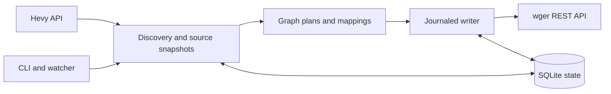

# Architecture

## Overview

The engine builds a graph of managed wger resources from Hevy snapshots, then applies it through a journaled writer.



## Components

### API clients

`api.py` implements Hevy pagination, wger schema/unit access and read/write outcome handling. The source is read-only; the destination receives REST writes without database access.

### Graph builder

`graph.py` converts supported strength records into ordered nodes with parent references, stable keys and deterministic UUIDs for sessions/logs. Saved templates and monthly history graphs remain separate. Mappings must be approved before supported exercises are written.

### Engine

`engine.py` binds accounts, discovers source snapshots/events, computes plans and runs incremental/full reconciliation. It persists source records before advancing checkpoints and revisits pending work independently.

### Writer and state

`writer.py` compares expected managed fields, checks conflicts/cascades and records write intentions. `state.py` stores snapshots, mappings, remote IDs, expected data, checkpoints and uncertain outcomes in SQLite. Integer-ID resources use ownership markers or parent/iteration keys for read-back recovery.

## Data flow

`check` validates identity, schema and units. `preview` discovers source records and plans without destination writes. `sync` preflights supported mappings, applies the graph, records managed fields and resumes held work. A daily full reconciliation checks unchanged destination fields; `sync --full` requests that immediately.

Multiple API requests cannot share one wger transaction. Partially imported structures can be visible until a later journaled run finishes. Unknown write outcomes are reconciled rather than blindly repeated.

## Directory layout

```text
src/hevy_wger/       Config, CLI, discovery, graph, writer and state
tests/              Unit fixtures, mock Hevy and real-wger integration tests
test_harness.py     Isolated integration runner and cleanup
examples/           Existing-wger Compose overlay and environment example
scripts/            Release metadata checks
reports/            Ignored JUnit outputs
```

Trace the plan with `docker compose run --rm connector preview --json` before importing. [Usage](usage.md) describes graph results and policies.
